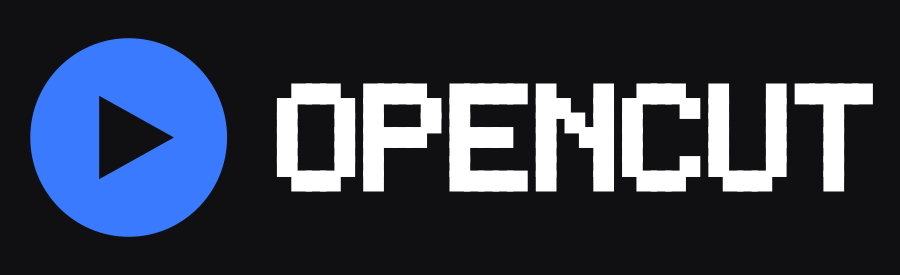

# OpenCut

An open-source video editor for Android.

- Package: `com.zaitxcode.opencut`
- Licence: MIT
- Everything is free: no subscription, no credits, no watermark, no paywall.

Every line of code, every asset and the logo itself were written from scratch for
this project. The app talks to no server and to no third party service: it only
reads and writes files on the device.

---

## What it does

* **Projects** — create, open, rename and delete drafts; each project is a single
  JSON document on disk.
* **Import** — videos, photos and audio from the system picker, or straight from
  the media library of the device through the built-in browser. Everything is
  copied into the app storage, so a project never breaks when a permission
  expires.
* **Timeline** — multiple tracks (canvas, audio, video, effect, sticker, text,
  overlay), drag a clip to move it, drag its edges to trim it, split at the
  playhead, duplicate and delete.
* **Preview** — an OpenGL ES 2.0 renderer that composites the layer stack and
  applies colour grading live, exactly the same way the exporter does.
* **Tool panels** — twelve tools, all visible at once: media, audio (add / volume
  / mute), text, sticker (six vector shapes), filters (seven colour LUTs),
  effects, adjust (nine sliders), transition (cross fade), speed, canvas ratio,
  crop (scale / rotation / opacity) and keyframes.
* **Keyframes** — per-layer animation of position, scale, rotation, opacity,
  volume and colour grading, linearly interpolated.
* **Export** — H.264 video through `MediaCodec`, AAC audio mixed from every audio
  layer, written into an MP4 with `MediaMuxer`, at 720p / 1080p / 1440p / 4K and
  24 / 30 / 60 fps.
* **Two languages** — English and Arabic, with a right to left layout. The
  language is chosen in the account screen and stays on the device.

## Free by design

There is no paid tier anywhere in the code base. `core/entitlements/Entitlements.kt`
is the single place that answers "can this be used?" and it always answers *yes*:

```kotlin
fun isUnlocked(feature: Feature): Boolean = true
```

The `Feature` enum lists what the editor can do — multi-track editing, keyframes,
4K export, watermark-free output — so the account screen can show the whole
catalogue with a `FREE` badge next to each item. It is deliberately *not* a
purchases table: there is no billing client, no licence check, no server call and
no flag that can turn a feature off. Forks inherit the same behaviour.

## Accounts are optional

On first launch the app offers two equal paths:

| Path | What is stored | What changes |
|---|---|---|
| **Continue without an account** | a guest profile (name + colour) | nothing, all features available |
| **Create a local account** | a display name and handle | nothing, all features available |

Both are stored in `files/account/profile.json` on the device and nowhere else.
There is no network account, no e-mail, no password and no analytics. Signing out
deletes that one file and keeps every project. `AccountStore` is intentionally
small enough to audit in a minute.

## Content providers

OpenCut ships with a complete offline catalogue (filters, effects, transitions,
stickers) generated at runtime, so it needs no provider at all.
`core/providers/AssetProvider.kt` defines an optional interface for adding more
content from a catalogue **you host yourself**:

```kotlin
interface AssetProvider {
    val id: String
    val displayName: String
    val worksOffline: Boolean
    suspend fun catalogue(): List<RemoteAsset>
    suspend fun download(asset: RemoteAsset, destination: File): File
}
```

`RemoteAsset` carries a mandatory `license` field and `HttpAssetProvider` refuses
to list or download anything whose licence is blank. That keeps the project from
turning into a distribution channel for artwork nobody is allowed to redistribute.

### Why the catalogue is empty by default

The app ships without any hosted asset catalogue. Effects, filters, templates and
stickers of a commercial service are proprietary artwork that cannot be
redistributed in an open-source project, and calling such a service from a
third-party client would breach its terms of use. The provider interface exists so
that people who want a hosted catalogue can run their own, with assets they
created or properly licensed.

See [`docs/PROVIDERS.md`](docs/PROVIDERS.md) for the catalogue format.

## Branding



The logo is original vector artwork built from a 5x7 block alphabet: a play badge
over the `OPENCUT` wordmark (`res/drawable/ic_launcher_foreground.xml` and
`ic_wordmark.xml`). The in-app lockup is composed at runtime in
`ui/theme/Brand.kt`, so there are no binary image assets and the mark stays sharp
at every density. `ic_launcher_monochrome.xml` is the themed-icon layer. The PNGs
in `docs/branding/` are renders of those vectors, included for documentation only.

## Architecture

```
app/src/main/java/com/zaitxcode/opencut/
├── core/
│   ├── account/        UserProfile · AccountStore (local only)
│   ├── entitlements/   Feature catalogue — everything unlocked
│   ├── model/          Project · Track · Segment · Material · Keyframe · Canvas
│   ├── editor/         EditorStore — every mutation, undo/redo
│   ├── media/          MediaProbe — container metadata
│   ├── providers/      AssetProvider · LocalAssetProvider · HttpAssetProvider
│   ├── render/         FrameComposer · PreviewRenderer · VideoDecoder · Shaders
│   ├── export/         ExportEngine · AudioMixer
│   └── store/          ProjectStore — JSON persistence
└── ui/
    ├── account/        OnboardingScreen · AccountScreen
    ├── home/           project list
    ├── editor/         EditorScreen · PreviewPane · TimelineView · DockBar
    │   └── panel/      Panels — one composable per tool
    ├── export/         ExportScreen
    └── theme/          Theme · Brand (logo, wordmark, badge)
```

### The data model

The central idea is the pair of time ranges on every segment:

```kotlin
data class Segment(
    val source: TimeRange,   // where inside the media file the content comes from
    val target: TimeRange,   // where it sits on the project timeline
    …
)
```

Splitting, trimming and changing the speed move those two ranges independently,
which is what keeps an export correct after any number of edits.

### Rendering

One renderer serves both the preview and the exporter:

```
MediaCodec ──► SurfaceTexture ──► external OES texture
                                        │
                              FrameComposer.drawLayer()
                                 ├─ transform (position / scale / rotation / alpha)
                                 └─ grading uniforms (14 sliders)
                                        │
                       GLSurfaceView  │  MediaCodec encoder input surface
```

## Releases

Download the latest build from the
[GitHub releases page](https://github.com/zaitxcode/opencut/releases):

| Version | File | Size | SHA-256 |
|---|---|---|---|
| 1.0.3 | `opencut-1.0.3.apk` | 1.58 MB | `8360db497afb9c8b98ea1769cc968a82ddd461d692dc2d1afcb0a93b2812444c` |
| 1.0.3 | `opencut-1.0.3.aab` | 3.91 MB | `91de9c7cf54ab456f45df1d860cec664a923101e7e9480b6008e44d7c3f71506` |
| 1.0.2 | `opencut-1.0.2.apk` | 1.45 MB | `6a2f5ad0a3c4961bc127105fe78483c4518175f8606f04054c4ff109074e66d0` |
| 1.0.2 | `opencut-1.0.2.aab` | 3.75 MB | `2dbba847ac1941b1114beaea77218d3dda0a54a7ebf4267565c6ba747c1d2cdf` |

Install the APK with `adb install opencut-1.0.2.apk` or by opening it on the
phone. It works without an account; creating one is optional and stays on the
device.

### 1.0.3 — every tool works, and the app speaks Arabic

* images, videos and audio can be imported from the system picker **or** from the
  media library of the device, which is now browsable inside the app
* photos and stickers are drawn from their real content instead of a placeholder
* the twelve tools of the editor are all visible on two rows instead of hiding
  half of them behind a scroll
* the preview is a `TextureView` now, so it is composited like the rest of the
  screen and the top bar is never covered by it
* audio is mixed and muxed next to the video track, with the correct duration
* English and Arabic, with a right to left layout in Arabic
* the interface language can be changed in the account screen

### 1.0.2 — preview, playback and export fixes

* the preview now shows the decoded video: frames are latched into the external
  texture instead of being dropped, and layers are centred on the canvas
* playback has a real clock: the playhead advances in real time and stops at the
  end of the project
* tapping a clip in the timeline selects it, so the filter and adjust panels
  apply to the right layer
* image, sticker and text layers are drawn with a 2D sampler — the external one
  only accepts video frames
* the exporter latches the decoded frames, sets the presentation timestamp of
  every frame and keeps its own LUT cache, so the file has the right duration
  and frame rate (30 fps, 4.000 s for a 4 s project) and the filters are baked
  in
* the preview is letterboxed inside the surface, so a 9:16 project is never
  stretched

## Building

Requirements: JDK 21+, Android SDK with platform 37, Gradle 9.6 (the wrapper is
included).

```bash
cd opencut
./gradlew :app:assembleDebug        # build the APK
./gradlew :app:testDebugUnitTest    # run the unit tests
```

The debug APK is written to
`app/build/outputs/apk/debug/app-debug.apk`.

### Release build

```bash
./gradlew :app:assembleRelease    # R8 shrink + optimise + obfuscate, then sign
./gradlew :app:bundleRelease      # AAB for store upload
```

The release build runs R8 in full mode, shrinks resources and obfuscates every
class that is not reachable through the manifest or a keep rule. The result is
**1.45 MB** — down from 19 MB in debug — with the launcher icon, the splash and all
editor features intact.

Signing is read from `keystore.properties` in the repository root:

```properties
storeFile=/absolute/path/to/opencut-release.jks
storePassword=…
keyAlias=opencut
keyPassword=…
```

That file is git-ignored; without it the release build is produced unsigned.
Release APK: `app/build/outputs/apk/release/app-release.apk`
Release key SHA-256: `FE:39:7D:E1:CF:4D:CF:B8:5B:97:A7:F7:7A:11:86:74:75:E8:BE:49:72:8B:04:B4:13:30:61:51:3E:97:17:B3`

## Tests

`app/src/test/` covers the parts that can be checked without a device:

* `EditorStoreTest` — split, duplicate, speed, undo/redo, keyframes.
* `ProjectSerializationTest` — JSON round trip and forward compatibility.
* `RenderStateTest` — layer composition, transitions and LUT resolution.
* `EntitlementsTest` — proves every feature stays unlocked.

22 tests, all passing.

## Status

| Area | State |
|---|---|
| Project model & persistence | working, tested |
| Editing operations | working, tested |
| Timeline interaction | move, trim, split, duplicate, delete |
| Preview renderer | working |
| Panels | media, audio, text, sticker, filter (LUT), effect, adjust, transition, speed, canvas, crop, keyframe |
| Export | implemented (video + mixed audio) |
| Transitions | cross fade implemented in the renderer and the exporter |
| Colour LUTs | seven built-in looks, generated analytically as 32×1024 strips |
| Accounts | optional, local only (guest or named profile) |
| Language | English and Arabic, right to left in Arabic |
| Feature gating | none — every feature unlocked |
| Curve speed, chroma key, masks, colour wheels | modelled in the data layer, not yet rendered |
| Templates, AI features, cloud sync | not implemented |

## Licence

MIT — see [LICENSE](LICENSE). The logo and icon are part of the project and are
covered by the same licence.
